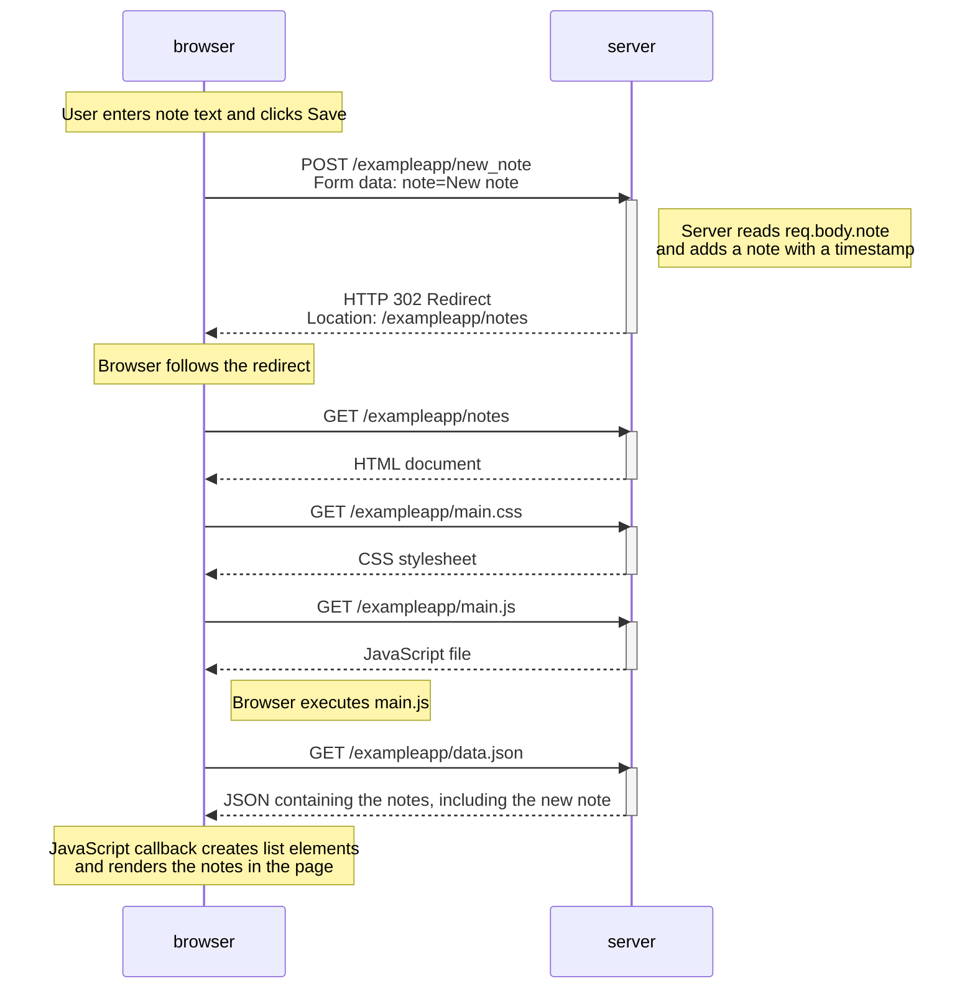

# Exercise 0.4: New note diagram

This diagram shows what happens when a user writes a note in the traditional Notes page (`/exampleapp/notes`) and clicks **Save**.

## Explanation

1. The browser submits the form using an HTTP **POST** request to `/exampleapp/new_note`. The note text is sent as form data.
2. The server reads the submitted text, creates a note object (including its creation time), and adds it to the notes collection.
3. The server responds with **302 Found** and a `Location` header pointing to `/exampleapp/notes`.
4. The browser follows the redirect with a new **GET** request. It receives the Notes page HTML and fetches its CSS and JavaScript files.
5. The JavaScript file requests `/exampleapp/data.json`. Once the JSON response arrives, a callback creates the HTML list elements and displays the notes.

**Key point:** This is the traditional form-submission flow. The browser reloads the Notes page after the POST because the server redirects it.
