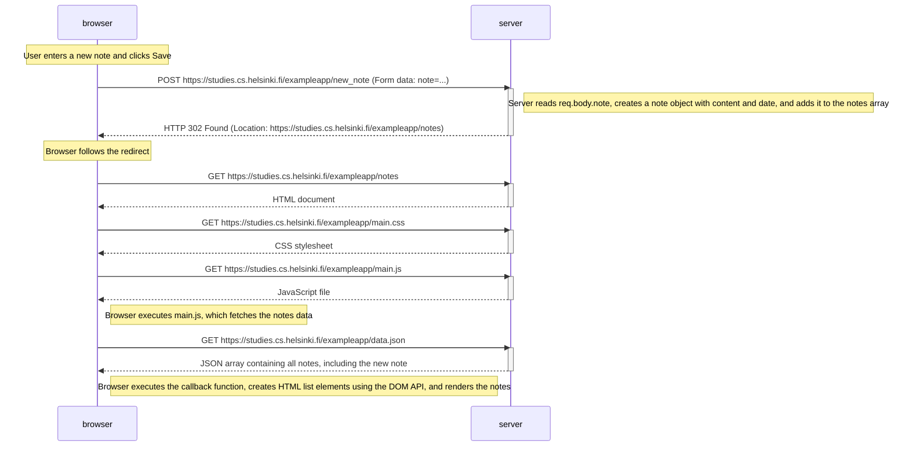

# Exercise 0.4: New note diagram

This diagram illustrates what happens when a user creates a new note in the traditional Notes application by entering text and clicking the Save button.

## Explanation

1. The user enters a note and clicks Save. The browser sends an HTTP POST request to `/exampleapp/new_note`, containing the note text as form data.

2. The server reads the submitted data from `req.body.note`, creates a note object containing `content` and `date`, and adds it to the notes array.

3. The server responds with HTTP 302 Found and a Location header pointing to `/exampleapp/notes`.

4. The browser follows the redirect by sending a new HTTP GET request to the Notes page.

5. The browser downloads the HTML document, CSS stylesheet (`main.css`), and JavaScript file (`main.js`).

6. The browser executes `main.js`, which sends another GET request to `/exampleapp/data.json` to retrieve the notes.

7. After receiving the JSON response, the JavaScript callback function creates HTML list elements using the DOM API and displays all the notes, including the newly created one.

**Key concept:** Traditional form submission uses an HTTP POST request followed by an HTTP redirect (302). The browser reloads the page and fetches the required resources again.