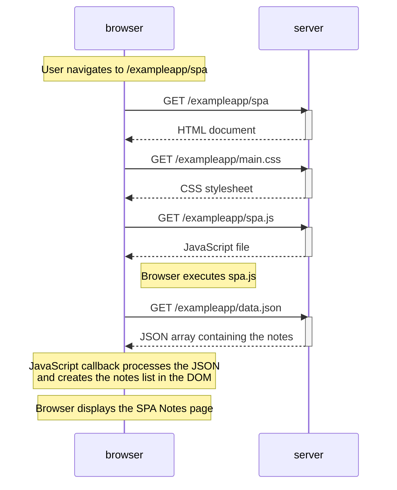

# Exercise 0.5: Single page app diagram

This diagram shows what happens when a user opens the Single Page Application (SPA) version of the Notes app at `/exampleapp/spa`.

## Explanation

1. The browser requests `/exampleapp/spa` and receives the HTML document.
2. The HTML references the stylesheet and the SPA JavaScript file, so the browser fetches `main.css` and `spa.js`.
3. The browser executes `spa.js`. The script sends a **GET** request to `/exampleapp/data.json`.
4. The server returns the notes as JSON.
5. JavaScript processes the response and uses DOM operations to create and display the notes list.

**Key point:** The browser builds the notes list using JavaScript. The page does not need a separate HTML document for the notes data; it fetches the data as JSON and updates the DOM.
