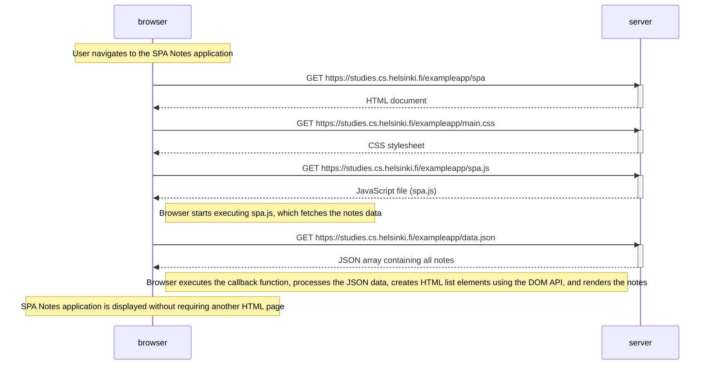

# Exercise 0.5: Single page app diagram

This diagram illustrates what happens when a user opens the Single Page Application (SPA) version of the Notes application in the browser.

## Explanation

1. The user navigates to the SPA Notes application. The browser sends an HTTP GET request to `/exampleapp/spa`.

2. The server responds with the HTML document.

3. The browser identifies the resources referenced in the HTML and downloads the CSS stylesheet (`main.css`) and JavaScript file (`spa.js`).

4. The browser starts executing `spa.js`, which sends an HTTP GET request to `/exampleapp/data.json`.

5. The server responds with the notes in JSON format.

6. The browser executes the callback function, processes the JSON data, creates HTML list elements using the DOM API, and renders the notes on the page.

**Key concept:** A Single Page Application uses JavaScript running in the browser to manage and update the page content. The browser fetches data separately from the server instead of requesting a new HTML page for displaying the notes.