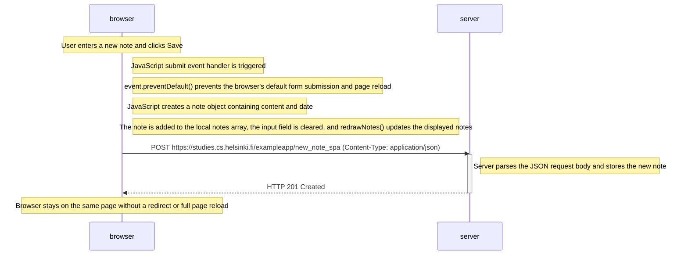

# Exercise 0.6: New note in Single page app diagram

This diagram illustrates what happens when a user creates a new note in the Single Page Application (SPA) version of the Notes application.

## Explanation

1. When the user enters a note and clicks Save, the JavaScript form submission handler is triggered.

2. The handler calls `event.preventDefault()` to prevent the browser's default form submission behavior, which would otherwise reload the page.

3. JavaScript creates a new note object containing two properties: `content` and `date`.

4. The new note is added to the browser's local notes array using `notes.push(note)`. The input field is cleared, and `redrawNotes()` updates the displayed list immediately.

5. JavaScript sends the new note to the server using an HTTP POST request to `/exampleapp/new_note_spa`. The note is sent as JSON, and the request includes the `Content-Type: application/json` header.

6. The server processes the JSON data, stores the note, and responds with HTTP 201 Created.

7. The browser remains on the same page. There is no redirect, no full page reload, and no additional request to reload the Notes application.

**Key concept:** Unlike traditional form submission, an SPA handles form submissions using JavaScript and sends data asynchronously to the server. The browser updates the interface without reloading the entire page.